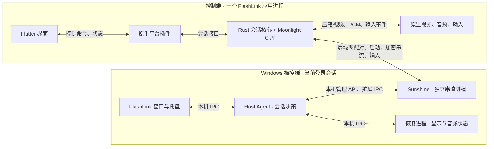

# FlashLink V1 总体技术架构

2026-11-23 · V1 架构决策 · 待原型验证

**当前交付范围**是安卓手机、安卓平板连接 Windows。两端打开应用，通过附近设备列表发现电脑，第一次由 Windows 用户确认，以后点设备直连。iPadOS 暂缓，Windows 控制端留在后续规划。下文的三端设计是扩展方案。当前安装包、授权方式与源码构建见[试玩说明](DEMO.md)。

**FlashLink 的自研主语言选 Rust。** V1 采用单仓库。三个控制端共享一个 Flutter 应用和一套 Rust 会话核心，Windows Host 独立运行。 Windows 安装包同时支持连接别的电脑和接受其他设备连接。Android 与 iPadOS 提供控制端。用户在局域网内打开 FlashLink，首次配对后即可连接自己的 Windows 桌面。产品范围见[项目规划](FlashLink_Project_Plan.md)，上游选型和许可依据见[前期评审](review.md)。

Flutter/Dart 负责界面。Rust 负责配对、会话、重连、输入映射、Windows 主机控制与隐私恢复。Sunshine 及其补丁沿用 C++，Moonlight 核心和 libopus 沿用 C。Windows 媒体插件使用 C++，Android 与 iPadOS 分别使用 Kotlin 和 Swift 对接系统媒体能力。首版音频暂按接管 Windows 当前输出的立体声设计，含系统提示音。三端控制、已登录且解锁的 Windows、一次安装备齐组件、隐私黑屏、1440p 级 60 帧主验与高刷设备验证 120 帧，沿用已确认需求。

## 语言选择与维护成本

游戏里点了“断开”，解码器可能还在回调，Wi-Fi 可能也恰好重连。Rust 可以把会话、恢复记录和资源释放顺序交给明确的所有者，用枚举列出失败与取消状态，并对共享数据的跨线程使用做编译期检查。**收益集中在项目会长期改动的逻辑。** 显卡编码由 Sunshine 调用，客户端的硬解和显示由系统执行，项目自己的 Rust 代码无需逐像素处理。

这个选择也增加了 Cargo 与三个原生构建系统的集成工作。Moonlight 的 C 回调、Windows API 的句柄和系统异步事件仍需要人工保证生命周期和时序。因此三端共用一层窄 C ABI，集中封装 Moonlight 回调的注册、取消和释放。新增会话规则只改 Rust，Sunshine 扩展随上游用 C++ 维护。第一阶段从干净检出分别构建三端，反复触发连接、取消和重连，检验跨语言实现。[Microsoft Rust for Windows](https://github.com/microsoft/windows-rs) · [Rust FFI 与异步回调](https://doc.rust-lang.org/nomicon/ffi.html) · [Rust 的静态库产物](https://doc.rust-lang.org/reference/linkage.html#linkage)

## 1. 运行时由谁负责什么



图中的 Windows 窗口与控制端界面来自同一个 Flutter 应用。关闭窗口后，托盘继续提供入口。Host 生命周期独立于界面。仅连接其他电脑时，启动客户端核心即可。局域网发现、配对、串流均在设备之间完成。

| 代码模块 | 语言与技术 | 职责、接口与边界 |
| --- | --- | --- |
| 应用界面 | Flutter / Dart | 一套设备页、配对、画质、会话页和设置。平板提供双悬浮球，Windows 提供键鼠、全屏和 Host 管理页。页面订阅状态快照，用户操作发出命令。 |
| Flutter 平台插件 | Pigeon 生成 Dart / Kotlin / Swift / C++ 控制接口，少量 JNI、Objective-C++ 桥接 | 接入系统发现、权限、密钥与原生播放视图。把连接命令交给共享核心。完整视频帧与 PCM 样本留在原生管线。 |
| 客户端会话 | Rust，向平台插件导出窄 C ABI | 共用配对状态机、设备证书绑定、能力协商、Desktop 选择、输入映射、启动、取消、断线与重连。各平台提供 HTTP/TLS、签名、密钥和显示能力实现。状态只由一个串行执行器写入。 |
| 客户端串流适配 | Rust FFI 封装 `moonlight-common-c`（C）和 libopus（C） | `LiStartConnection` 启动接收，压缩视频交平台硬解，Opus 解码成 PCM。把触点、鼠标、按键转换成上游输入事件。C 结构体、裸指针和回调上下文止于此边界。 |
| Android 播放与输入 | Kotlin / JNI，MediaCodec、Surface、AudioTrack | 压缩视频送入解码器，在原生 Surface 显示。音频写入 AudioTrack。处理 Surface 重建、前后台、实际刷新率和触摸。 |
| iPadOS 播放与输入 | Swift / Objective-C++，VideoToolbox、原生显示层、AVAudioEngine | 将视频参数集与压缩单元交给解码器，原生图层呈现。处理音频路由、中断、手动旋转及高刷时序。 |
| Windows 播放与输入 | C++20，Media Foundation、D3D11、WASAPI | 解码到 GPU 纹理，在原生窗口或合成表面呈现。处理实体键鼠、焦点切换与音频输出。第一次运行探测可用的硬解格式。 |
| Windows Host Agent | Rust + Microsoft `windows` crate，独立普通用户权限进程 | 拥有唯一控制席位、授权策略和活动会话状态。启动和监督私有 Sunshine 实例，调用其本机配对管理 API，响应锁屏、注销和撤销授权。 |
| Host 媒体引擎 | 上游 Sunshine / C++，独立进程 | 复用桌面采集、GPU 编码、系统声音采集、媒体传输和输入执行。FlashLink 的小补丁接入会话准入、隐私状态和新流就绪事件。 |
| 隐私与恢复 | Rust + `windows` crate，Host 可执行文件的独立 `--guard` 运行模式 | 在修改显示或本地音频前保存状态，是 FlashLink 中唯一修改及恢复这些系统状态的组件。设计目标是 UI、Agent 或引擎退出后仍可完成恢复。 |
| 安装、更新与诊断 | Windows 安装器建议 Inno Setup，构建用 CMake / PowerShell，指标收集用原生代码 | 安装器一次带齐引擎、运行库和已验证可再分发的必要驱动。更新程序校验发布包并在用户确认后安装。各端产出相同定义的会话指标。 |

Pigeon 用于低频跨语言控制。Android / iPadOS / Windows 保留各自的播放表面，避免每一帧都经过 Dart。先试 Flutter 控件覆盖原生视频，再用高刷真机同时测动画、拖动和悬浮球。若合成开销超过一帧预算，可将全屏播放与高频手势收进原生视图，共享设备页和会话接口仍可复用。[Flutter 平台通道](https://docs.flutter.dev/platform-integration/platform-channels) · [Android 原生视图的合成取舍](https://docs.flutter.dev/platform-integration/android/platform-views) · [MediaCodec](https://developer.android.com/reference/android/media/MediaCodec) · [VideoToolbox](https://developer.apple.com/documentation/videotoolbox/vtdecompressionsession) · [Media Foundation 与 D3D11](https://learn.microsoft.com/en-us/windows/win32/medfound/supporting-direct3d-11-video-decoding-in-media-foundation)

## 2. 仓库、构建目标与依赖方向

V1 的源码按以下目录组织。一个目录可以包含多个逻辑模块。仅对独立部署、跨语言或确有测试隔离需要的部分设立构建目标。

```text
apps/flashlink/                   Flutter 应用和三端 runner
  lib/features/                  devices、pairing、session、settings、host
packages/flashlink_platform/     Flutter 插件，含 Pigeon 定义和 Dart 接口
  android/                       Kotlin 宿主、JNI、解码呈现、音频和系统适配
  ios/                           Swift 宿主、Objective-C++、视频与音频适配
  windows/                       C++ 宿主、D3D11 播放、托盘与 Host IPC 客户端
Cargo.toml                       自研 Rust 代码的 workspace 入口
crates/client/                   Rust 客户端核心与供三端链接的 staticlib
  include/                       平台插件使用的 C ABI 与回调契约
  src/                           pairing、session、input、stats、ffi
crates/stream/                   Moonlight / libopus 的安全封装与内部 FFI
crates/host-windows/             flashlink-host.exe（Cargo / MSVC）
  src/agent/                     会话准入、引擎监督、配对管理、托盘接口
  src/guard/                     显示与音频事务、锁屏确认、故障恢复
contracts/                       Host IPC 与 FlashLink 扩展的消息规范、版本与样例
upstream/                        固定提交、子模块、构建选项、Sunshine 小补丁
packaging/                       Windows 安装/便携包、更新、三端发布清单与许可
tests/                           跨组件契约、集成测试、真机验收场景与参考素材
```

**构建产物。** Cargo 为每个目标生成一份 `flashlink_client` 静态库，C 依赖按同一目标编译且在最终产物中只链接一次。Android 由 Gradle/NDK 链接成 JNI 原生库。iPadOS 由 Xcode 分别链接真机与模拟器产物，可用 XCFramework 交付。Windows 使用 MSVC 工具链，CMake 链接 Flutter 插件，Cargo 构建 Host，可复现地构建含小补丁的 Sunshine。固定 Rust stable 版本、Cargo.lock、Flutter SDK 和各端工具链版本。单元测试就近放在所属模块，跨进程与真机用例集中在 `tests/`。[Rust Android 目标](https://doc.rust-lang.org/rustc/platform-support/android.html) · [Rust Apple 移动设备目标](https://doc.rust-lang.org/rustc/platform-support/apple-ios.html)

**允许的依赖。** Dart 页面只依赖插件契约。平台插件把系统服务注入 Rust 客户端，`client` 调用 `stream` 的安全接口，后者封装上游 C 库。GUI 和客户端只持有不透明会话句柄。Host 与 Sunshine 通过接口跨进程协作。Windows 控制端即使与 Host 同包，也不链接 Host 的显示或音频恢复代码。普通业务模块用安全 Rust。必要的 `unsafe` 集中在 C ABI、上游回调和 Win32 包装中，注明谁持有资源、何时释放、能在哪个线程调用。

**上游基线。** 原型候选为 Sunshine `v2026.914.233613`（`63d35f70`）与 Moonlight 核心 `b4ee1cea`。构建锁记录完整提交、Moonlight 要求的 ENet 子模块提交、libopus、编译选项、补丁和驱动包摘要。以下链接是本次核对的源码，组合兼容性要在 P0 实测。升级时先重放补丁并做配对、加密、媒体、隐私四类回归。[Sunshine 提交](https://github.com/SunshineStream/Sunshine/commit/63d35f702ee9e362e43263742981836ec0710384) · [Moonlight 核心提交](https://github.com/moonlight-stream/moonlight-common-c/commit/b4ee1cea3d19e13c0b37c26585e6b1ee174effcb) · [上游 ENet 约束](https://github.com/moonlight-stream/moonlight-common-c#note-to-developers)

## 3. 连接、信任与接口契约

1. **发现。** 安卓首页自动刷新附近 FlashLink 电脑。Windows 在引擎和本机管理认证都就绪后响应 UDP 47980 的本地子网发现消息，带回电脑名、主机证书指纹与当前端口。客户端按证书身份合并设备，首次连接还需要本机人工授权。
2. **配对。** 安卓通过固定主机证书的 TLS 通道提交一次性编号和临时 PIN，并以同一编号开始 Moonlight 握手。Windows 将两个请求的编号和来源相匹配，向本机用户显示设备名称及与安卓相同的确认码；允许或拒绝只作用于这条待配对记录。两端保留经过握手验证的证书，下一次可直接进入 Desktop。Sunshine 管理接口仅由 Windows 应用在本机调用。[固定版配对接口](https://github.com/SunshineStream/Sunshine/blob/v2026.914.233613/src/confighttp.cpp)
3. **开始会话。** 已配对控制端查询 Desktop，调用上游 `/launch` 或 `/resume`。产品版在两个入口共用准入逻辑。Host 确认当前 TLS 对端、Windows 活动会话已解锁、单一席位可用，并处理本次隐私意图。成功后返回串流地址，控制端调用 `LiStartConnection`。普通或旧客户端也经过同一门禁。如果请求的功能版本不兼容，明确返回原因。[Sunshine 会话入口](https://github.com/SunshineStream/Sunshine/blob/63d35f702ee9e362e43263742981836ec0710384/src/nvhttp.cpp) · [Moonlight 会话启动示例](https://github.com/moonlight-stream/moonlight-ios/blob/master/Limelight/Stream/StreamManager.m)
4. **开始输入。** 控制端确认当前流首帧已经由本地显示模块呈现。FlashLink 客户端发送带本次会话标识的回执，Host 打开本次输入通道。迟到回执只属于旧流。需要这一回执的隐私会话在开始前协商扩展能力。普通可见桌面可以支持上游客户端的正常就绪流程。

| 边界 | 建议接口 | 所有权与约束 |
| --- | --- | --- |
| Dart ↔ 平台插件 | `discover`、`pair`、`connect`、`setPrivacy`、`disconnect`。事件为设备列表、会话状态、错误和统计快照 | 发起耗时命令立即返回操作标识，最终结果以事件通知。命令参数中没有主机管理密钥，视频与 PCM 留在原生层。 |
| 平台插件 ↔ 客户端核心 | 内部 C ABI 提供启动、取消、停止、输入及状态回调。原生播放端实现接收压缩视频、接收 Opus 解码后的 PCM、刷新呈现表面 | 核心拥有状态机。平台拥有 Surface、图层、音频设备和身份句柄。回调缓冲区生命周期到回调返回为止，异步使用时复制压缩数据或取得明确所有权。 |
| 窗口、引擎 ↔ Host Agent / Guard | 本机 Windows 命名管道，小型长度前缀消息及版本化 JSON。不同角色各有允许的消息集合 | 限定本机和当前登录 SID，为子进程建立可验证的 IPC 身份。设置消息上限，拒绝网络管道客户端。Agent 独占会话决策，Guard 独占系统状态写入。 |
| Host Agent ↔ Sunshine 管理 | 受认证的本机 HTTPS，用于待配对请求、PIN、查看和撤销设备。引擎配置用 FlashLink 私有路径 | 管理凭据只在 Host 保存。安装配置限定管理访问为本机，局域网串流强制加密、关闭 UPnP，只开放私有网络所需入口。 |
| 控制端 ↔ FlashLink 引擎扩展 | 沿用已配对的 HTTPS。拟定义能力查询、启动隐私意图、会话中设置隐私、查询状态、首帧回执 | 扩展是计划开发的接口。Host 从当前连接取对端证书，再核对活动席位。首次启动仅携带客户端生成的 `requestId` 和隐私意图，Host 成功占位后签发 `sessionId` 与 `generation`。后续 FlashLink 扩展操作携带三者，同一已认证设备重试复用结果。过期命令返回旧会话错误。 |

对外错误至少区分未配对、证书变化、电脑已锁、其他设备占用、画质组合不可用、隐私切换失败、连接中断。界面根据错误给出可执行动作，如本地解锁、重新配对或选择一个已经验证的档位。版本协商允许未来增加字段，未知的必要功能在修改显示或声音之前返回不兼容。[Sunshine 配置](https://docs.lizardbyte.dev/projects/sunshine/v2026.914.233613/md_docs_2configuration.html) · [Windows 本机管道的访问控制](https://learn.microsoft.com/en-us/windows/win32/ipc/named-pipe-security-and-access-rights)

## 4. 会话生命周期与崩溃恢复

**客户端。** `Idle → Preparing → Starting → Streaming → Stopping → Idle`。证书配对是独立的持久操作，连接中的中断可转入 `Reconnecting`。每次发起媒体连接都分配本地代次，用来隔离旧回调。Host 另行签发线上代次，用来拒绝旧控制命令。Rust 状态机按顺序消费事件，阻塞的上游启动运行在专用线程。正在启动时，取消路径调用 `LiInterruptConnection` 并等待那次启动返回。已启动后由生命周期所有者调用 `LiStopConnection`。旧回调完全退出、解码器释放后才能重新启动。只忽略旧事件不足以解决裸指针悬空，必须同时守住回调上下文的寿命。[Moonlight 生命周期接口](https://github.com/moonlight-stream/moonlight-common-c/blob/b4ee1cea3d19e13c0b37c26585e6b1ee174effcb/src/Limelight.h)

**Host。** `Idle → Reserved → Preparing → Streaming → Closing → Idle`。Agent 原子地把席位授给当前设备证书与 Windows 登录会话。第二个请求收到“电脑正在使用”。非正常断开可从 `Streaming` 转入 `ReconnectGrace`，只允许原设备在原登录会话内恢复。逻辑会话 ID 保持，重建媒体流增加代次。超时、锁屏或撤销信任即停输入并使旧凭据的本次会话权限失效。Windows 进入锁定、注销或切换用户时，主机停止采集与输入。仅当前物理控制台的登录会话可运行接收连接的引擎。快速用户切换时，先释放旧席位与监听端口，再由新会话取得主机所有权。明确解锁后才接受新的连接。

**隐私事务。** Agent 负责是否允许操作，Guard 负责实际改动。引擎设置 `dd_configuration_option=disabled`，将显示控制交给 Guard。音频也采用同一所有权约定，引擎采集 Guard 已选的端点，P0 验证能阻止引擎重复切换系统音频设备。隐私是标准安装版的发布条件，优先验证签名的虚拟显示驱动。该驱动只承担提供显示输出的职责。

| 触发 | Guard 与引擎的动作 | 可观察结果 |
| --- | --- | --- |
| 启动或中途开启隐私 | Guard 先把原拓扑、音频设备及自身改动范围持久化，验证虚拟显示可用，再切换到仅虚拟输出。Sunshine 切换采集源或执行受控的媒体短重连，丢弃旧帧并从关键帧恢复。 | 只有物理输出状态已核对、控制端显示了新代次首帧，才显示“隐私已开启”并接收输入。失败时回滚，等待用户决定。 |
| 正常退出 | “锁屏并断开”走锁屏确认流程。“回到电脑继续”是用户明确要求恢复桌面。 | 原显示器和可用音频状态恢复，已拔掉的设备不会阻塞退出。 |
| 隐私下 Wi-Fi 中断或控制端崩溃 | 即刻释放远端按键，保留隐私输出。仅接受原控制端短时重连，建议先测 10 秒。超时后在交互会话请求锁屏，确认正确 Windows 会话已锁，才恢复物理屏。 | 用户回到电脑时看到锁屏。计时值待真机调参。 |
| Agent、Sunshine 或 Guard 单独崩溃 | Guard 在独立于引擎和 Agent 的生命周期中持有恢复日志。引擎失联时 Guard 执行恢复。Agent 管道关闭或准入租约失效时，Sunshine 补丁立即释放远端按键、停止输入和媒体，Guard 独立执行先锁屏再恢复的流程。Guard 崩溃时 Agent 停止媒体并重启 Guard 回放日志。异常重启后，Host 接受新连接前检查未完成事务。 | 单次恢复可重复执行。系统状态未知时保持隐私、重试并提供本机主动恢复入口。新会话不能接管旧日志。 |

Guard 对显示和音频的写前记录用临时文件、原子替换及持久化完成标记。恢复前对照实际状态，保留用户在会话期间主动选择的新音频设备。若热插拔产生新物理输出，立即将隐私状态改为“重新验证”，阻断输入，重新应用并核对仅虚拟输出。若无法恢复隐私，执行锁屏保护。在支持清单中记录是否存在可见的短暂画面。锁屏请求是异步的，利用相应登录会话的 WTS 事件和可查询状态确认。**锁屏后 Guard 能否在目标 Windows 版本上成功恢复拓扑，以及异常时是否短暂露出原桌面，要以实体屏验证**。[Windows 锁屏语义](https://learn.microsoft.com/en-us/windows/win32/api/winuser/nf-winuser-lockworkstation) · [Windows 登录会话状态](https://learn.microsoft.com/en-us/windows/win32/api/wtsapi32/ns-wtsapi32-wtsinfoex_level1_w) · [Windows 显示配置](https://learn.microsoft.com/en-us/windows/win32/api/winuser/nf-winuser-setdisplayconfig)

## 5. 视频、声音、输入和数据存放

| 路径 | 数据如何走 | 产品约束及验证 |
| --- | --- | --- |
| 视频 | Sunshine 在 Windows 捕获选定显示器，使用可用 GPU 编码。控制端收到压缩帧后直交原生硬解与显示模块。原生回调仅传递描述符或必要的压缩数据。 | 首先跑通 H.264、SDR、8-bit、4:2:0。在真机编码、解码、显示结果均可验证时开放 HEVC、120 Hz 或 4:4:4。软件回退要能看见。混合显卡、色彩范围、文字缩放单独测。 |
| 声音 | Sunshine 采集当前 Windows 输出并编码为 Opus。三端共用 libopus。以本地音频设备时钟和样本计数播放 PCM，按视频呈现时间戳安排视频。 | 默认声音随控制端播放。可关闭转发或允许本机播放。先测 WASAPI 静音前采样和本地临时静音，必要的虚拟音频设备随安装包提供。上游音频回调提供压缩包，双轨同步用同步闪光与短音实测。 |
| 输入 | 平板原生播放表面接收高频位置事件，Flutter 悬浮球和键盘提供鼠标、滚轮、快捷键及文本意图，统一进入 Rust 输入映射。Windows 实体键鼠走同一套语义。 | 按**实际视频内容矩形**反算坐标，忽略黑边内点击，支持手动横竖屏与 180°。按键边沿、拖动和输入法提交文本保持顺序。切后台或失焦时释放，Host 在断线时也释放。 |
| 拥塞与统计 | 界面保留用户选择。原生管线分别记录收帧、解码、实呈帧率、队列时长和丢帧，低频汇总给 Dart。 | 延迟超预算时限制队列积压，按上游接口请求关键帧。不能任意丢弃有依赖的编码帧。弱网提示调整档位，改变目标前征得用户同意。静态 Galgame 对话按新画面变化与响应验收。 |

**持久化分工。** 客户端保存 Host 证书指纹、设备别名、最后成功地址和画质意图。平台保管私钥，Rust 使用身份句柄委托签名和 TLS 客户端认证。原型要验证系统密钥支持上游配对所需算法。Android 首选 Keystore，Apple 使用 Keychain，Windows 使用当前用户证书存储或 DPAPI。Agent 的引擎配置和凭据放在当前用户的受限目录。Guard 的恢复日志独立于个人偏好，且包含主机登录会话和事务 ID。配置带版本号、以原子替换升级。诊断导出排除私钥、PIN、认证材料和音视频内容。[Android Keystore](https://developer.android.com/privacy-and-security/keystore) · [Moonlight Android 配对代码](https://github.com/moonlight-stream/moonlight-android/blob/master/app/src/main/java/com/limelight/nvstream/http/PairingManager.java) · [WASAPI 的采样位置](https://learn.microsoft.com/en-us/windows/win32/api/audioclient/ne-audioclient-audclnt_streamoptions)

## 6. 安装、版本与交付

标准 Windows 安装包一次提供经过验证的引擎、运行库及隐私和音频所需组件，在安装阶段完成系统授权、自检和防火墙设置。默认手动启动，允许随用户登录启动。设备已有独立 Sunshine 时检查配置及端口冲突，不覆盖现有设备信任库。便携包以解压可启动为目标，已有系统组件可复用。全新 Windows 机器上的免驱黑屏仍待独立实测。Windows 自动检查并下载签名更新，等待用户确认和会话退出再安装。保留配对与配置并支持失败恢复。移动端按各自商店或测试发行渠道升级。

发行清单锁定应用、上游、驱动与协议扩展的版本。链接 Moonlight 的客户端组合按 GPLv3 安排发布，Sunshine 二进制及补丁随版本提供相应源码、许可证与构建方法。独立原创模块可保留 MIT。移动商店例外按每个包实际包含的组件核对。Windows 普通鼠标与键盘先验证上游提供的 SendInput 路径。虚拟显示驱动核对签名及再分发权，再选定型号和版本。[现有许可分析](review.md) · [Moonlight 商店分发条款](https://github.com/moonlight-stream/moonlight-common-c/blob/b4ee1cea3d19e13c0b37c26585e6b1ee174effcb/LICENSE.txt) · [Sunshine 固定版本指南](https://docs.lizardbyte.dev/projects/sunshine/v2026.914.233613/md_docs_2getting__started.html)

## 7. 两人如何从骨架走到验收

| 阶段 | 主机侧开发者 | 客户端侧开发者 | 合流条件 |
| --- | --- | --- | --- |
| P0a · 第一条真实链路 | FlashLink Host 对接官方 Moonlight，打通安装、首次配对与受控重连。 | FlashLink Client 对接原版 Sunshine，打通 Rust 核心、一个真机画面、立体声和一次翻页。三端编译相同版本的 C 依赖。 | 两个交叉组合及 FlashLink 双端在同一局域网工作。保存原版对原版的同条件基线。 |
| P0b · 高风险边界 | 在干净 Windows、双屏和双显卡上实测虚拟显示、锁屏确认、音频恢复、强退各进程与局域网强制加密。 | Android、iPadOS、Windows 都能发布构建并呈现带帧号素材。反复取消连接、重建画面、拔耳机及重连，查悬空回调、卡音和漏键。 | 三端 Rust 与 C 的生命周期可复现。隐私实验记录实际物理屏结果。若驱动、锁屏后拓扑恢复或实时渲染未达标，先修对应模块。 |
| P1 · 每日可用 | 托盘、单席位、撤销、异常恢复、安装更新。 | 自动发现、直接触控、双悬浮球、Windows 键鼠、横竖屏与能力协商。 | 普通用户只打开 FlashLink 即可完成首次授权、游玩、断开和再次进入。 |
| 公开测试 | 两人共同覆盖不同 GPU、主流与高刷设备、较弱 Wi-Fi，在干净环境验收最终安装包和打包许可证。 | 归档参考画面、媒体参数、原生呈现指标及故障复现条件。 | 主验 1440p 级 60 帧和连续立体声，高刷组合记录实际 120 帧结果，公布代表性设备和限制。 |

**测试分层。** 每次变更运行 Rust 状态机/代次、配对错误、输入坐标、隐私日志幂等及 IPC 契约测试。Windows、macOS 与 Android 构建任务分别验证各平台产物，CI 可以用假设备和压缩媒体样本覆盖常规回归。真机验收用相同源素材与显式的分辨率、色度、码率、加密和网络条件。连续运动测唯一实呈帧与帧间隔 P95/P99，用细小字缘和渐变图检查画质，用闪光与短音测音画偏移。同一台高速相机拍摄点击与反馈测交互延迟。逐台目视检查隐私与恢复，确认延迟及兼容性指标之后再写入支持表。

**第一轮端到端验收**依次观察首帧呈现、首句语音完整播放、触控正确翻页，以及隐私会话断线后先锁屏再恢复物理显示。架构与语言分工已定，驱动兼容性、音频路由和真实性能留给 P0 真机验证。
