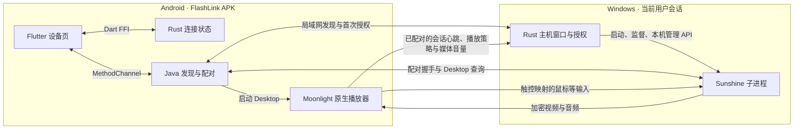

# FlashLink 当前架构

FlashLink 在同一 IPv4 局域网内，把已登录、已解锁的 Windows 10/11 x64 桌面串流到 Android arm64 手机或平板。Windows 应用管理 Sunshine 的生命周期和首次授权，Android 应用发现主机并启动内嵌的 Moonlight 播放器。两端保存配对身份，后续连接可以直接进入桌面。

## 运行时与代码入口

| 模块 | 当前职责 | 源码入口 |
| --- | --- | --- |
| Windows 主机 | Rust 与 Win32 实现主窗口和允许／拒绝弹窗。就绪检查涵盖引擎子进程、GameStream 服务和仅本机可用的 HTTPS 管理接口。Job Object 随主机退出清理 Sunshine。 | [主机编排](../crates/host-windows/src/service.rs)、[本机管理](../crates/host-windows/src/management.rs) |
| Windows 媒体引擎 | Sunshine 采集 Windows 桌面及系统声音，选择可用编码器，发送加密串流并执行回传输入。专用配置只发布名为 `Desktop` 的桌面入口。 | [引擎配置](../crates/host-windows/src/profile.rs) |
| Android 界面与状态 | Flutter 展示附近设备、处理刷新和播放设置。Dart 调用 Rust 的 C ABI 校验目标并分配连接编号；同时只允许一个活动的播放器打开请求，重复点击和旧回调按编号处理。 | [Flutter 控制器](../apps/flashlink/lib/connection.dart)、[Rust C ABI](../crates/client/include/flashlink_client.h) |
| Android 原生串流 | Java 适配器通过平台通道接收设备选择，负责发现、初次确认、查找已配对主机及启动桌面。Moonlight 完成协议握手、原生视频解码、声音播放和输入回传。媒体帧直接进入原生管线。 | [Android 宿主](../apps/android/src/main/java/com/limelight/FlashLinkActivity.java)、[会话入口](../apps/android/src/main/java/com/limelight/FlashLinkSessionActivity.java)、[Moonlight 集成补丁](../apps/android/moonlight-v12.1.patch) |

## 从发现到直连

1. **发现。** Android 在局域网发送带随机值的 UDP 查询。已就绪的 Windows 主机在端口 `47980` 回送该随机值、电脑名、串流基准端口和主机证书的 SHA-256 指纹。安卓按证书指纹合并设备，使用应答报文的来源 IP 建立连接。串流基准端口默认为 `47989`。[安卓发现](../apps/android/src/main/java/com/limelight/FlashLinkDiscovery.java) · [主机发现与授权队列](../crates/host-windows/src/lan.rs)
2. **首次授权。** Android 连接基准端口减 8 的 TLS 服务，核对服务证书与发现指纹，再发送一次性请求编号、临时 PIN 和设备名称。同时，Moonlight 以同一编号发起配对。Windows 匹配请求编号和来源地址，在两端展示由主机指纹前缀与临时 PIN 组成的确认码。Windows 用户核对并允许后，主机程序向 Sunshine 本机管理接口批准对应请求；拒绝或超时会结束本次授权。[安卓授权通道](../apps/android/src/main/java/com/limelight/FlashLinkConsent.java) · [Windows 授权处理](../crates/host-windows/src/service.rs)
3. **保存身份。** Moonlight 完成握手并核对主机证书后，Android 将主机身份写入其设备库；Sunshine 保存已授权的客户端身份。Windows 默认将主机证书、配对记录和日志保存在当前用户的 `%LOCALAPPDATA%\FlashLink\DemoHost`。[客户端身份处理](../apps/android/src/main/java/com/limelight/FlashLinkSessionActivity.java) · [Windows 配置目录](../crates/host-windows/src/profile.rs)
4. **再次连接。** Android 从新的发现应答取得最新地址，用保存的证书验证主机和配对状态，通过已认证连接查询 `Desktop` 的实际应用 ID，再启动原生播放器。电脑更换局域网 IP 后仍可按证书识别；主机证书变化或配对已失效时，需要重新确认。

## 播放、重连与隐私

Flutter 呈现手机设备列表及平板的列表／详情双栏。串流打开后由 Android 原生播放器管理覆盖在画面上的鼠标和工具面板。重连逻辑监听实际媒体回调，使用单调时钟、退避间隔与 15 秒期限；只使用已配对身份，主动断开不触发重连。播放器将分时段的接收帧、提交至 Surface 的帧以及丢帧写入诊断计数。[原生播放器](../apps/android/src/main/java/com/limelight/FlashLinkGame.java) · [重连策略](../apps/android/src/main/java/com/limelight/FlashLinkReconnect.java)

Windows 主进程提供系统托盘、逐设备撤销和报告导出。EXE 和便携 ZIP 中的主程序都嵌入了 MttVDD 驱动、签名目录和默认配置。主机启动时自动检查并准备防窥驱动和服务，只在需要写入系统配置时请求管理员授权。主窗口和 Sunshine 继续以用户权限运行。防窥默认关闭，主机只在用户开启、已授权安卓会话仍在线且虚拟显示输出可用时切换显示。[内置显示组件](../crates/host-windows/src/privacy_driver.rs) · [主机会话](../crates/host-windows/src/service.rs)

启用防窥后，独立 Rust 守护进程保存显示恢复信息，调用 Windows 显示配置 API，仅启用已识别的 MttVDD 虚拟输出并检查活动显示路径。安卓在原生播放器运行时通过双向 TLS 发送心跳；主机按 Sunshine 中已授权的客户端证书验证身份。心跳中断约 5 秒后进入 15 秒宽限期；期限结束后，守护进程停止串流并恢复实体屏。已授权的串流期间出现持续显示异常时，守护进程先尝试恢复原布局并继续串流，主机窗口会提示隐私已退出。主机确认恢复完成且本机已解锁后重新开启引擎与发现，沿用原配对记录。诊断文件记录这些状态的先后顺序。[显示拓扑](../crates/host-windows/src/privacy_display.rs) · [隐私守护进程](../crates/host-windows/src/privacy.rs) · [安卓心跳](../apps/android/src/main/java/com/limelight/FlashLinkPrivacyLease.java)

## 会话内调整串流画质

首帧显示后，Android 在当前 Sunshine 会话的加密可靠 ENet 控制通道查询码率调节能力。`0x6A40` 请求携带两个小端 32 位整数，分别为非零请求编号与目标总码率（Kbps，零表示查询）。主机仅在当前使用支持动态码率的 H.264 NVENC 编码器时报告支持。调整时主机沿用建流时的纠错、音频和协议开销计算，在两帧之间调用 `NvEncReconfigureEncoder`，再通过 `0x6A41` 返回请求编号、结果和已确认的总码率。视频、音频、输入和防窥心跳继续使用原会话。

帧率使用独立的请求与回执（`0x6A42`、`0x6A43`），查询格式相同，目标值用整数 FPS 表示。主机调整当前会话的编码节奏和 NVENC 的帧率参数，Windows 共享采集按活动会话所需的最快节奏运行。各会话独立限帧，桌面显示模式保持原样。Android 按主机确认的帧率更新播放器的呈现节奏。

分辨率请求与回执使用 `0x6A44` 和 `0x6A45`。尺寸字段的高 16 位是宽度，低 16 位是高度，零表示查询。主机为当前会话准备目标尺寸的缩放器和编码器，在新尺寸的关键帧就绪后切换，并更新指针坐标映射。原桌面显示模式、其他客户端及音频通道继续沿用原配置。Android 使用支持自适应播放的 H.264 解码器，按解码输出更新画面布局，主机回执与新尺寸的画面均到达后才保存设置。

Android 分别探测各项能力，按请求编号匹配回执。设置请求超时后会查询实际值。组合调整及当前会话不支持的操作沿用重连和画质回滚流程。[Sunshine 补丁](../integrations/sunshine/live-settings.patch) · [Moonlight 控制通道](../apps/android/moonlight-common-live-settings.patch) · [Android 请求处理](../apps/android/src/main/java/com/limelight/FlashLinkLiveSetting.java)

## 串流声音与 Windows 主音量

两个安卓入口读写同一组播放位置和断开偏好。播放器启动前会用已配对证书探测主机能力。支持声音控制时，Moonlight 请求 Sunshine 保留默认播放设备，Windows 继续采集该设备的 WASAPI 回环音频。安卓单独调整串流 `AudioTrack` 的增益，所以「仅电脑播放」也能读到用户真实的媒体音量。老主机沿用 Moonlight 的播放协商。[安卓设置](../apps/android/src/main/java/com/limelight/FlashLinkAudio.java) · [播放器](../apps/android/src/main/java/com/limelight/FlashLinkGame.java)

两端都支持开流前静音时，选择「仅手机或平板播放」会先向 Windows 发送准备请求。Windows 成功静音默认输出后才应答，安卓收到确认才启动媒体。若启动取消或准备心跳过期，主机会撤销这次临时静音。串流建立后，安卓通过双向 TLS 心跳更新播放位置、断开策略、媒体音量百分比和静音状态。Windows 按客户端身份、会话编号和包序号接收更新。主动退出附带最终音量，画质切换使用单独的交接消息。[安卓会话通道](../apps/android/src/main/java/com/limelight/FlashLinkPrivacyLease.java) · [Windows 消息处理](../crates/host-windows/src/audio_wire.rs)

声音控制心跳超出重连宽限期时，Windows 检查当前 Sunshine 进程是否仍持有媒体音频端口。媒体仍在线时保留串流路由，会话结束后用最后收到的样本执行断开策略。「跟随」写入音量和静音状态，「保持电脑静音」只设静音，保留 Windows 滑块位置。如果默认设备暂时不可用，运行中的主机会在设备恢复后重试。串流切回本机播放时，主机只撤销 FlashLink 施加的临时静音。[声音策略](../crates/host-windows/src/audio.rs) · [媒体端口检查](../crates/host-windows/src/media_transport.cpp) · [Windows Core Audio](../crates/host-windows/src/audio_endpoint.cpp)

## 构建

Windows 构建脚本从 Sunshine `v2026.914.233613` 的固定提交编译带会话内画质调整补丁的引擎。打包工具校验官方资源包和引擎构建记录，将新引擎及归档的 SHA-256 编入 Rust 主程序，再生成离线单文件 EXE 和便携 ZIP。单文件版按引擎归档摘要缓存运行时，升级后会解包对应版本。[Sunshine 构建](../crates/host-windows/build-sunshine.sh) · [Windows 打包](../crates/host-windows/bundle.py)

Android 构建脚本从固定提交的 Moonlight Android `v12.1` 应用补丁，将 Flutter AAR、Rust 动态库和 Moonlight 原生库打进同一个 APK。[Android 构建](../apps/android/build.py)
