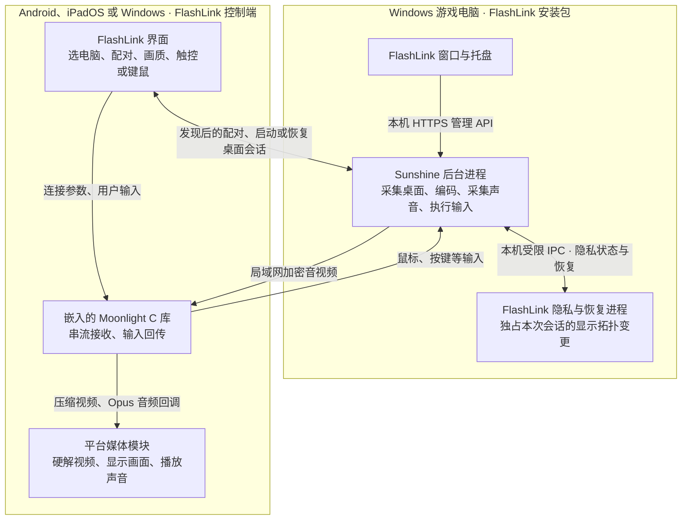

# FlashLink V1 架构评审稿

2026-11-23 · 供项目发起人审核 · 设计阶段

本文保留前期需求和上游接口的核对依据。V1 已选定 Rust 编写自研核心和 Windows 主机控制，详细分工见[总体技术架构](ARCHITECTURE.md)。

FlashLink V1 面向开源用户。Windows 提供被控端，Android、iPadOS 和 Windows 都提供控制端。局域网内连接已经登录且解锁的电脑。主验 1440p 级别的 60 帧、清晰文字和稳定音频，同时在高刷设备验证 120 帧。标准安装一次备齐依赖，隐私黑屏是必备功能。下文的技术栈、驱动和重连时长供审核。画质与帧率数字是验收目标。[项目规划](FlashLink_Project_Plan.md) · [仓库 README](https://github.com/RicardoMin/FlashLink/blob/main/README.md)

首版音频暂按接管当前 Windows 输出设计，具体设备上的路由行为仍需验证。

## 建议采用的架构

**用户安装的是 FlashLink。Windows 被控端的安装包内含独立运行的 Sunshine 程序。Android、iPadOS 和 Windows 控制端把 Moonlight 官方提供的 C 库编进自己的应用。** 两端在同一局域网直接通信。Windows 应用同时提供“连接电脑”和“允许本机被连接”两个入口。

**用一次 iPad 上的点击看接口边界。**

1. 用户点设备列表中的“家里的电脑”。首次连接时，FlashLink 在 iPad 上显示 PIN，Windows 弹窗让用户输入。Windows 端用本机管理接口 `POST /api/pin` 确认指定配对请求。下次点同一台电脑，信任记录仍有效就直接启动。该管理接口只处理授权，视频有单独的数据通道。[Sunshine 固定版管理 API](https://docs.lizardbyte.dev/projects/sunshine/v2026.914.233613/md_docs_2api.html)
2. iPad 上的 FlashLink 用已配对身份选中 Desktop，通过 `/launch` 或 `/resume` 拿到会话地址，调用 `LiStartConnection` 并注册媒体回调。Sunshine 把游戏桌面和声音编码传过来。Moonlight 核心把收到的压缩视频与 Opus 音频交给回调，我们接入 iPad 的 VideoToolbox、原生显示和音频播放。Android 和 Windows 共用这段会话逻辑，各自接入平台的硬件解码与音频输出。[上游会话启动示例](https://github.com/moonlight-stream/moonlight-ios/blob/master/Limelight/Stream/StreamManager.m#L114-L140) · [Moonlight 核心接口](https://github.com/moonlight-stream/moonlight-common-c/blob/master/src/Limelight.h)
3. 用户点游戏里的“下一句”。FlashLink 根据视频的实际显示区域把触点换算成桌面坐标，调用 `LiSendMousePositionEvent` 和 `LiSendMouseButtonEvent`。Moonlight 负责回传，Sunshine 在 Windows 执行鼠标操作。游戏绘制下一句，再沿同一条视频链路送回 iPad。界面框架只处理设备页、设置和手势，逐帧视频留在原生媒体管线。[Moonlight 输入接口](https://github.com/moonlight-stream/moonlight-common-c/blob/master/src/Limelight.h)

首个原型先跑通这三步，使用原版 Sunshine 对照验证。V1 必备的隐私开关还需增加能识别当前已配对会话的控制接口，以及切换显示、确认物理屏停显、掉线锁屏后恢复的主机逻辑。复用显示配置和配对 API 后，仍由 FlashLink 实现并验收完整的隐私行为。

| 部分 | 首选实现与边界 |
| --- | --- |
| Windows 被控端 | 随 FlashLink 分发固定版本的 Sunshine 引擎，使用应用私有配置、设备身份和受限的本机管理接口。复用桌面采集、NVENC / AMF / Quick Sync、软件编码回退、Opus 和输入执行。用户已有的 Sunshine 实例可能占用默认端口，启动前识别并给出明确结果，保留对方的配对和配置。 |
| 三端共享 | 设备列表、发现结果、配对流程、画质意图和设置页共享。连接协议由同一份原生核心承载。应用层还要实现发现、首次配对、获取 Desktop 条目及启动或恢复会话。固定核心提交和对应的 ENet 子模块。 |
| Android | 用 MediaCodec 向原生 Surface 输出，以真机检查支持的 profile、尺寸、帧率和低延迟模式。用系统音频输出播放解码后的立体声。 |
| iPadOS | 用 VideoToolbox 解码并以原生视频图层呈现。以实际显示时序统计刷新率。将黑边、横竖屏、180° 与触点映射一起测试。 |
| Windows 控制端 | 原生视频模块首选 Media Foundation 硬解和 D3D11 呈现，音频用 WASAPI 播放。使用实体鼠标和键盘，保留全屏退出入口。与 Host 共用 Windows 安装包，允许只运行控制端。 |

三端用 Flutter/Dart 共用设备页、配对、画质设置及悬浮面板，Rust 核心统一管理会话。Windows 主机管理和恢复进程使用 Rust，托盘插件与 Media Foundation 播放模块使用 C++。Android 用 Kotlin/JNI 对接 MediaCodec，iPad 用 Swift/Objective-C++ 对接 VideoToolbox。帧与 PCM 样本留在原生管线，仅把控制命令和低频统计交给界面。原型同时测 120 Hz 视频、叠加悬浮控件和持续拖动。若 Flutter 合成导致掉帧，保留共享管理页，将全屏串流视图和高频手势放入原生视图。[Flutter 桌面插件](https://docs.flutter.dev/platform-integration/desktop) · [Android 原生视图的合成取舍](https://docs.flutter.dev/platform-integration/android/platform-views) · [Android MediaCodec](https://developer.android.com/reference/android/media/MediaCodec) · [Apple VideoToolbox](https://developer.apple.com/documentation/videotoolbox/vtdecompressionsession) · [Windows D3D11 硬解](https://learn.microsoft.com/en-us/windows/win32/medfound/supporting-direct3d-11-video-decoding-in-media-foundation)

Sunshine 官方实现覆盖多家 GPU，Moonlight 核心提供媒体和输入接口，移动客户端另有会话启动代码。框架级替代方案是原生 libwebrtc，能复用拥塞控制和音频抖动缓冲，但 Windows 硬编适配、三端播放和配对仍要做。只有固定版本套件在加密、高画质或发布许可上出现无法接受的约束，才重评传输层。Apollo 的虚拟显示随客户端切换值得作为显示实验的对照。[Sunshine](https://github.com/SunshineStream/Sunshine) · [Moonlight 核心](https://github.com/moonlight-stream/moonlight-common-c) · [iOS 会话代码](https://github.com/moonlight-stream/moonlight-ios/blob/master/Limelight/Stream/StreamManager.m) · [WebRTC 编码器接口](https://webrtc.googlesource.com/src/+/refs/heads/main/api/video_codecs/video_encoder_factory.h) · [Apollo 虚拟显示](https://github.com/ClassicOldSong/Apollo#about-virtual-display)

### 接入与信任关系

1. 首次发现使用局域网 DNS-SD/mDNS。设备名和 IP 只用于展示与寻址。控制端也允许手动输入地址。iPadOS 请求本地网络权限，Android 接入系统 NSD。[Apple 本地网络隐私](https://developer.apple.com/documentation/technotes/tn3179-understanding-local-network-privacy) · [Android 局域网发现](https://developer.android.com/develop/connectivity/wifi/use-nsd)
2. 原型锁定已核对接口的 Sunshine `v2026.914.233613`。平板或 Windows 控制端显示一次性 PIN，Host 原生授权窗口让用户输入并确认，本机通过受保护的 `/api/pin` 完成指定配对请求。管理凭据只保存在 Host。客户端固定配对得到的 Host 证书。设备私钥使用平台安全存储。重装导致身份变更时重新配对。撤销设备时结束其活动会话。[固定版本配对与设备 API](https://docs.lizardbyte.dev/projects/sunshine/v2026.914.233613/md_docs_2api.html)
3. 控制端自动选择 Desktop。启动或恢复会话后，通过加密媒体会话接收画面和声音。将局域网加密设为强制。客户端显式请求所有流加密，并在测试中验证拒绝未加密连接。安装时只为局域网串流开放需要的入口，管理接口仅允许本机访问。V1 默认关闭公网端口映射。后续若扩展公网，需要单独设计信令和中继。[固定版本配置](https://docs.lizardbyte.dev/projects/sunshine/v2026.914.233613/md_docs_2configuration.html) · [客户端连接参数](https://github.com/moonlight-stream/moonlight-ios/blob/master/Limelight/Stream/Connection.m)
4. 隐私开关和状态回执是 FlashLink 的功能。原型先验证一个小型、带版本号的 HTTPS 扩展，沿用配对的客户端证书。首次以隐私模式连接时，已认证的启动请求携带隐私意图。Host 原子地预留会话，完成显示切换与本机预检后才放行视频，收到客户端首帧回执后开放输入。会话中切换隐私时，Host 从当前 TLS 连接识别设备并核对本次会话，只允许当前控制端操作。扩展只提供启动意图、读取状态、设置隐私等限定操作。上游本机管理 API 继续只给 Host 界面调用。扩展以独立补丁维护，并与选定引擎版本一起做升级回归。[Sunshine 会话 HTTPS 实现](https://github.com/SunshineStream/Sunshine/blob/v2026.914.233613/src/nvhttp.cpp)

### 画面、声音和触控

视频先打通 **SDR、8-bit、H.264 4:2:0**。双方通过试编码和试解码后，开放 HEVC、较高分辨率和刷新率。比较静态小字和转场后再确定默认编码。记录色彩矩阵、量程、实际色度及额外拷贝，特别测混合显卡和虚拟显示路径。4:4:4 单独列实验档，必须同时满足采集与转换保留色度、编码 profile 匹配、客户端可持续硬解、最终像素正确。现有协议有相应标记，而上游 Android 和 iOS 建连代码声明的格式更少。AV1、HDR 和数学无损可后续扩展。[Moonlight 格式定义](https://github.com/moonlight-stream/moonlight-common-c/blob/master/src/Limelight.h) · [Android 格式声明](https://github.com/moonlight-stream/moonlight-android/blob/master/app/src/main/java/com/limelight/Game.java) · [iOS 格式声明](https://github.com/moonlight-stream/moonlight-ios/blob/master/Limelight/ViewControllers/MainFrameViewController.m)

画质页提供简单预设和实际协商结果。用户选定分辨率、帧率及档位后保存设置。超出设备能力时在连接前列出可用组合，等用户确认。弱网时优先播放连续音频、限制视频积压、请求关键帧恢复，显示丢帧和调整建议。用户决定是否降低目标帧率或画质，重连沿用已确认的配置。软件编码回退要能看见，性能超出软件能力时重新确认可用档位。

音频范围暂按“接管当前 Windows 输出，包括系统通知，默认只在控制端播放”设计。客户端可以关闭音频转发，或允许本机也播放。若要求只接管指定游戏，需要另行实现进程级捕获和该游戏的输出路由。传输采用 Opus 立体声，保留 BGM 的左右声道与动态范围。Moonlight 的音频回调提供 Opus 包，客户端以解码样本计数和本地音频设备时钟安排播放。视频按可用的呈现时间戳安排显示，限制两端队列并用同步闪光和短音测持续播放后的偏移。若需要精确关联两轨源时间戳，再评估给核心增加元数据。语音聊天常用的降噪、自动增益和回声消除默认关闭。隐私黑屏和本地声音开关可以独立设置。优先验证 WASAPI 在端点静音前取样的路径，保留板载声卡、USB 耳机、HDMI 的实测记录。若某类端点需要虚拟音频设备，标准安装包必须一并解决该依赖。[Microsoft 回环采样行为](https://learn.microsoft.com/en-us/windows/win32/api/audioclient/ne-audioclient-audclnt_streamoptions) · [Sunshine 音频设备配置](https://docs.lizardbyte.dev/projects/sunshine/v2026.914.233613/md_docs_2configuration.html) · [Opus 媒体格式](https://www.rfc-editor.org/rfc/rfc7587.html)

移动端默认直触定位。鼠标悬浮球提供精确移动、左右键、滚轮和拖动，控制面板呼出系统键盘和快捷键。系统输入法提交的中日文走文本事件，快捷键走按下与抬起事件。移动、点击与拖动统一使用当前显示变换。切后台或断线时释放远端按键。Windows 控制端将键鼠映射到同一套输入语义。[Moonlight 输入接口](https://github.com/moonlight-stream/moonlight-common-c/blob/master/src/Limelight.h)

## 用户从哪里开始

用户在已登录的 Windows 电脑上安装 FlashLink，在平板上打开 FlashLink，点一下自动发现的电脑。首次使用时，电脑显示设备名称，用户核对平板上的配对信息并授权。以后点已配对的电脑，就进入当前 Windows 桌面，可以点游戏选项、看字幕、听语音。设置页保留手动 IP，方便同一局域网内组播发现失败时连接。

标准安装包一次提供串流、音频和隐私黑屏所需的依赖。安装器在需要时处理系统授权，完成后做本机自检。首次游玩和首次打开黑屏使用已经安装好的组件。Windows 托盘能看到谁在连接、主动断开或撤销已配对设备。一个 Host 同时接受一个控制端，第二台设备收到“电脑正在使用”的提示。

V1 连接已登录且解锁的桌面。Host 订阅 Windows 会话锁定、切换和注销事件。锁屏期间拒绝采集与输入，在已配对客户端显示“电脑已锁定，请在电脑上解锁”。再次解锁后允许重新连接。Host 默认由用户启动，窗口关闭后驻留托盘。设置中可开启随用户登录启动。[Windows 会话通知](https://learn.microsoft.com/en-us/windows/win32/termserv/wm-wtssession-change)

## 隐私、屏幕比例与恢复

隐私黑屏是 V1 的发布条件。推荐验证签名虚拟显示驱动，用一个虚拟输出承载游戏桌面，在隐私会话里临时停用所有物理输出。标准安装包需要携带经过验证、可再分发的驱动包。在开启安全启动的干净 Windows 上走完整安装流程。签名、实际采集和安装体验都是选驱动的条件。[Microsoft 间接显示驱动模型](https://learn.microsoft.com/en-us/windows-hardware/drivers/display/indirect-display-driver-model-overview) · [Windows 显示拓扑接口](https://learn.microsoft.com/en-us/windows/win32/api/winuser/nf-winuser-setdisplayconfig)

进入隐私模式时，先保存活动显示器、主屏、布局、分辨率、刷新率和本次要改动的音频状态，由独立于媒体进程的恢复逻辑持有。验证虚拟输出可采集后切换拓扑，确认所有物理输出均已停用、平板收到有效画面，再将“隐私已开启”反馈给用户。切换失败就回滚。用户以隐私模式发起连接时，留在连接界面，等用户明确选择可见模式再进入。会话结束、引擎崩溃、网络失联超时、睡眠唤醒和下次启动都可触发恢复。显示器已拔出时恢复至当前可用物理输出。音频仅撤回本次会话所做且仍生效的更改。

**隐私会话意外断线时，先重连，再锁屏，最后恢复物理显示。** 断线立刻释放远端按键，保留虚拟桌面，给原已配对设备一个短暂的重连窗口（草案建议 10 秒，待真机调参）。超时后由交互式用户会话中的恢复进程请求锁屏，收到该会话的锁定通知才恢复物理拓扑。锁屏调用是异步的。引擎配置使用 `dd_configuration_option=disabled`，由恢复进程独占拓扑写入和恢复顺序。在引擎意外退出场景验证上游确实服从此顺序。若锁屏失败则保留隐私、重试，并提供本机明确触发的应急恢复方式。正常退出提供“锁屏并断开”和“回到电脑继续”，用可预期的结果结束会话。[Windows 锁屏语义](https://learn.microsoft.com/en-us/windows/win32/api/winuser/nf-winuser-lockworkstation) · [Sunshine 显示恢复配置](https://docs.lizardbyte.dev/projects/sunshine/v2026.914.233613/md_docs_2configuration.html)

默认等比完整显示。虚拟桌面可按平板比例请求可用分辨率。有些 Galgame 的内容固定为 16∶9，允许游戏保留黑边。触控映射使用实际内容区域，扣除黑边并反算缩放、旋转和显示器原点。黑边内的点击直接忽略。首次评审按同一套桌面由平板接管设计，多屏时选择一个画面串流，隐私测试检查所有物理屏幕。

## 如何验收画质、声音与响应

首个公开测试版在代表性设备上主验 **1440p 级、稳定 60 FPS、字幕清楚、声音连续**。16∶9 测试源用 2560×1440，其他比例写出实际协商像素。另在高刷设备记录 120 FPS 的结果与限制。保留 1080p60 兼容档，更高分辨率按能力开放。协议协商取主机编码、网络、客户端硬解和屏幕显示能力的交集。将目标帧率、收到的帧率和实际呈现的新帧率分开显示。

| 场景 | 验收方法 |
| --- | --- |
| 字幕、立绘、渐变 | 使用有授权的参考图或自制素材，包含细红字、小号日文假名、透明文字边框、暗部渐变。用相同源帧比较 Windows 原图与平板解码结果，再看真机实际缩放显示。分别记录色度、量程和码率。 |
| 高刷与响应 | 用带帧号的连续滚动和场景转场统计实际呈现的新帧、帧间隔 P95/P99 和丢帧。静态对话单测清晰度与翻页响应。用高速摄影同拍输入和反馈，另记源画面变化至平板显示的延迟。 |
| 语音、BGM 与音画同步 | 播放左右声道样本、带同步闪光的短音和“静音—首句语音—连续音乐”。检查首字截断、左右互换、爆音、断音和持续播放后的音画偏移。分别观察系统扬声器和耳机。 |
| 网络波动 | 在同一对设备上记录 Wi-Fi 与有线参考结果，然后引入可复现的丢包与抖动。观察提示、队列耗时、帧恢复及音频连续性，记录用户设定值和实际表现。 |
| 安装与恢复 | 干净机器完成安装、首连、配对、二次连接。开启隐私时拔网线、结束媒体进程、切换耳机、热插拔第二台显示器。实体屏逐一目视确认，断开后检查本地主屏、鼠标按键和声音。 |

测试矩阵按能力覆盖 Intel、AMD、NVIDIA，包含一台双显卡 Windows 设备、Android/iPadOS 平板、Windows 控制端、常规刷新率与高刷屏。每条记录带操作系统、驱动、硬件型号、协商结果及实测数据。先选能覆盖不同路径的代表性组合，社区可按相同方法补测。用同机同网、相同分辨率、帧率、码率及加密条件的 Sunshine + Moonlight 作性能对照，另记上游默认设置下的首次使用体验。

## 开源、打包与升级

Sunshine 和 Moonlight 核心的上游许可证都允许按 GPLv3 条款使用、修改和分发。Moonlight 明确把核心库推荐给希望开发自己客户端的项目。按这些条款使用上游开源代码，无论项目免费还是收费，都可以据此取得授权。[Sunshine LICENSE](https://github.com/SunshineStream/Sunshine/blob/v2026.914.233613/LICENSE) · [Moonlight 核心 README](https://github.com/moonlight-stream/moonlight-common-c#moonlight-streaming-core-library)

| FlashLink 的用法 | 建议的发布处理 |
| --- | --- |
| 自写的 Windows 管理界面调用 Sunshine 的本机 HTTPS API | 独立实现的程序可通过公开接口与 Sunshine 通信。界面的许可要结合实际代码和耦合方式判断，进程边界只说明运行方式。[GPLv3 第 5 节](https://github.com/SunshineStream/Sunshine/blob/v2026.914.233613/LICENSE#L187-L217) |
| 在 Windows 安装包中附带原样或修改过的 Sunshine | 保留上游版权和许可证。在同一 Release 提供与发出二进制对应的完整源码及所需构建脚本。发布修改版时同时标明改动及日期。该方案也适用于后续隐私扩展补丁。[GPLv3 第 4 至 6 节](https://github.com/SunshineStream/Sunshine/blob/v2026.914.233613/LICENSE#L175-L253) |
| 在三个控制端链接 Moonlight C 库 | 推荐将组合客户端整体按 GPLv3 分发并提供对应源码。仓库原有 MIT 文件保留其许可，独立原创模块可继续单独以 MIT 提供。发布组合应用时明确列出各组成和适用条款。[FlashLink LICENSE](https://github.com/RicardoMin/FlashLink/blob/main/LICENSE) · [Moonlight 核心 LICENSE](https://github.com/moonlight-stream/moonlight-common-c/blob/master/LICENSE.txt) |
| 通过应用商店分发 | Moonlight 核心和 iOS 客户端的许可证末尾有额外许可，条件包括另设不受商店限制的渠道提供 GPL 源码。FlashLink 需要使自身贡献和实际打包依赖的条款共同支持所选分发方式。[Moonlight 核心分发例外](https://github.com/moonlight-stream/moonlight-common-c/blob/master/LICENSE.txt#L600-L605) · [Moonlight iOS 分发例外](https://raw.githubusercontent.com/moonlight-stream/moonlight-ios/master/LICENSE.txt) |

驱动按各自的许可选择。此版 Sunshine 的可选 Virtual HID 输入驱动单独按机器收费，普通键鼠已有 Windows `SendInput` 路径。V1 推荐先用后者验证 Galgame 的点击和按键。隐私黑屏依赖的虚拟显示驱动另行核对签名和再分发权。以上是提议的发行安排，仓库许可变更由维护者审核。[Sunshine 固定版本 Windows 输入说明](https://docs.lizardbyte.dev/projects/sunshine/v2026.914.233613/md_docs_2getting__started.html)

标准安装版负责完整体验。便携包的目标是解压即运行，先验证在全新电脑上能否以免驱路径达到同样的隐私验收。已有签名组件时可直接复用。本稿把“全新电脑、免安装驱动、完整黑屏”列为待验证的交付组合，评审时保留这项差异。更新沿用规划中的自动检查和下载、用户确认后安装。界面、引擎、原生插件、驱动锁成经过联调的发布组合，升级保留已有配对和设置。

## 原型与评审顺序

| 阶段 | 要拿到的结果 | 决策用途 |
| --- | --- | --- |
| P0 · 安装与隐私 | 干净 Windows 安装后由 FlashLink 完成配对。验证锁屏拒绝、物理屏停显、首帧、断线锁屏后恢复和再次连接。测试时不打开上游管理网页。 | 确定打包的驱动、引擎启动方式和隐私切换边界。 |
| P0 · 媒体与输入 | 一个 Windows Host，三个只含解码、播放和输入的控制端原型，同一套核心接收真实桌面、立体声并回传一次点击。在代表性设备上比较 1440p60、1080p60、120 FPS 的实际表现。 | 尽早发现某个平台的解码、渲染、安装分发或性能瓶颈。 |
| P1 · 可日常游玩 | 三个控制端统一发现和授权。平板完成直触和双悬浮球，Windows 完成键鼠和全屏。一局游戏内完成黑屏切换、字幕翻页、读档、耳机切换和重连。 | 确认无需理解串流术语即可独立使用。 |
| 公开测试前 | 在文中列出的能力组合上发布实测表，主验 1440p60 与音频稳定性，附高刷测试结果。复查安装包、许可清单和恢复场景。 | 用实测确定默认画质、支持列表和已知限制。 |

本文是技术路线和验收提案。当前工作区只有规划资料，本轮未构建客户端、打包驱动或执行真机串流。
